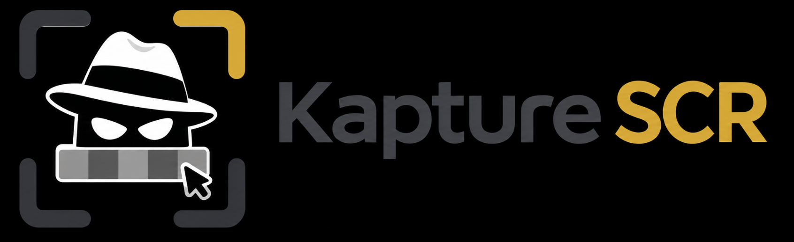

<p align="center">
  
</p>

# Kapture SCR

A small, private, offline screenshot tool for the macOS menu bar.
Capture, mark up, copy and save, with no network access and no telemetry.

## Features

- **Capture from the menu bar** with <kbd>⌘</kbd> <kbd>⇧</kbd> <kbd>6</kbd>, or from the menu › *Take Screenshot*. <kbd>Esc</kbd> cancels.
  - **Capture Window** with <kbd>⌘</kbd> <kbd>⇧</kbd> <kbd>7</kbd> (or from the menu): click any window to capture it whole, whatever mode is selected.
  - **Custom shortcuts:** menu › *Options* › *Change Capture Shortcut…*, *Change Window Shortcut…* and *Change Import Shortcut…* record a new combination. It needs at least two modifier keys including <kbd>⌘</kbd> or <kbd>⌃</kbd> (function keys work on their own); shortcuts reserved by macOS or already taken are rejected. *Restore Default* brings back <kbd>⌘</kbd> <kbd>⇧</kbd> <kbd>6</kbd>, <kbd>⌘</kbd> <kbd>⇧</kbd> <kbd>7</kbd> or <kbd>⌘</kbd> <kbd>⇧</kbd> <kbd>E</kbd>.
  - **Modes:** Selection (Kapture SCR's own crosshair overlay), Window (system camera picker) or Full screen (main display).
  - **Destination:** Clipboard, Folder, or both. Pick the folder once; Kapture SCR remembers it.
  - **Options:** timer (none, 3 s, 5 s, 15 s), format (PNG / JPG), show cursor, window shadow.
- **Adjustable selection** (menu › *Options* › *Adjust Capture Area*, off by default): when off, releasing the mouse captures the area at once. When on, the area stays on screen with handles after dragging. Drag a corner or an edge to resize it, drag inside to move it, or drag outside to start over. Arrow keys move it (<kbd>⇧</kbd> by 10 pt, <kbd>⌥</kbd> resizes). Capture with <kbd>Return</kbd>, a double-click inside, or the *Capture* button under the area.
- **Capture guide:** in Selection mode a small glass hint follows the pointer and invites you to press <kbd>Space</kbd>.
  <kbd>Space</kbd> morphs it into an options panel, which stays where you opened it, to pick a timer (none, 3, 5 or 15 s) with the mouse or <kbd>←</kbd> <kbd>→</kbd>; <kbd>Space</kbd>, <kbd>Return</kbd> or <kbd>Esc</kbd> closes it, and a second <kbd>Esc</kbd> cancels the capture. The choice is remembered.
- **Countdown:** delayed captures (Selection and Full screen) show a glass countdown with a progress ring over the area being captured; <kbd>Esc</kbd> cancels. It disappears before the shot is taken.
- **Design:** the guide, options panel, countdown, recent captures panel and editor use Apple's Liquid Glass material on macOS 26 and later (`glassEffect`, `GlassEffectContainer`), with a translucent material fallback on macOS 14–15. Every surface has a light and a dark version and follows the system appearance. They respect *Reduce motion* and *Reduce transparency*.
- **Languages:** English, Spanish, French, Portuguese (Brazil), Russian, Simplified Chinese, Hindi, Bengali, Arabic and Urdu, following the system language. Arabic and Urdu use a right-to-left layout.
- **Floating thumbnail** in the top-right corner for 5 seconds after each capture. Click it to open the editor; hovering keeps it visible.
- **Editor:** dark canvas with a floating glass toolbar and a filmstrip of recent captures. Tools: crop, arrow, text and opaque redaction (<kbd>⌘</kbd> <kbd>1</kbd>–<kbd>4</kbd>). Undo / redo (<kbd>⌘</kbd> <kbd>Z</kbd> / <kbd>⌘</kbd> <kbd>⇧</kbd> <kbd>Z</kbd>, up to five steps within 64 MiB).
  - <kbd>⌘</kbd> <kbd>S</kbd> *Save Copy* writes a new `… (edited).png` (translated) next to your captures. The original file is never touched.
  - <kbd>⌘</kbd> <kbd>⇧</kbd> <kbd>C</kbd> copies the edited PNG.
- **Import from the clipboard** with <kbd>⌘</kbd> <kbd>⇧</kbd> <kbd>E</kbd> (configurable): opens the copied image in the editor.
- **Recent captures panel:** hover over the menu bar icon to show a smoked-glass panel with your recent captures; click one to edit it or drag it into another app.
  *Auto images* optionally imports PNG/TIFF images you copy (off at launch, never persisted).
- File names look like `Kapture SCR 2026-11-17 13.05.22.png` in every language and never overwrite an existing file.
  The clipboard always receives lossless PNG; files use the format you chose.

## Requirements

- macOS 14 Sonoma or later.
- Xcode (the full app). The Command Line Tools alone are not enough on some setups.
- No third-party dependencies.

## Build from source

```sh
git clone <this-repo-url> kapture_scr
cd kapture_scr
DEVELOPER_DIR=/Applications/Xcode.app/Contents/Developer ./scripts/build-local.sh
open ~/Applications/"Kapture SCR.app"
```

The script builds a release binary, wraps it in `dist/Kapture SCR.app`, signs it with the App Sandbox entitlements and installs it to `~/Applications/Kapture SCR.app` (quitting any running copy first). The build copy in `dist/` is then removed so Spotlight and the Apps launcher list only the installed app.
Pass `--no-install` to only build into `dist/`.

Do not run the binary in `.build/` directly: it lacks the signature and therefore the sandbox.
Do not disable Gatekeeper or SIP. If you downloaded the folder as an archive, remove only its quarantine flag: `xattr -dr com.apple.quarantine .`

### Disk image for other Macs

```sh
DEVELOPER_DIR=/Applications/Xcode.app/Contents/Developer ./scripts/make-dmg.sh
```

Creates `dist/Kapture SCR <version>.dmg`: a drag-to-install window (app, link to *Applications*, background with instructions) and the app icon as the volume icon. Arranging the window needs permission for Terminal to control Finder the first time (System Settings › Privacy & Security › Automation); without it the image is still built, just without the layout.

The app is signed with the local certificate (or ad hoc) and **not notarized**, since that needs a paid Apple Developer account. On another Mac:

1. Open the disk image and drag *Kapture SCR* to *Applications*.
2. On first launch macOS says it cannot verify the developer. Open System Settings › Privacy & Security and click **Open Anyway** (only once). Copies that never had a quarantine flag, such as ones copied from a USB drive, open directly.
3. Allow **Screen Recording** when asked, then reopen the app.

Updates signed with the same certificate keep the Screen Recording permission.

### Expected entitlements

- `com.apple.security.app-sandbox`
- `com.apple.security.files.user-selected.read-write` – only the folder you choose.
- `com.apple.security.files.bookmarks.app-scope` – to remember that folder.

There is **no** network entitlement.

### Signing and the Screen Recording permission

Kapture SCR captures through `/usr/sbin/screencapture`, so macOS asks for **Screen Recording** permission the first time (System Settings › Privacy & Security). Reopen the app after granting it.

macOS ties that permission to the app's code signature. With an ad hoc signature it is lost on every rebuild. To keep it across builds, create a self-signed **code signing** certificate named `Kapture Local Signing` in your login keychain (Keychain Access › Certificate Assistant › Create a Certificate…, type *Code Signing*). No Apple account is needed. The build script uses it automatically when present and falls back to ad hoc signing otherwise.

If you delete or replace the certificate, reset the old grant with:

```sh
tccutil reset ScreenCapture local.kapture.app
```

## Translations

User-facing strings use English keys looked up with `L("…")` in `Sources/Kapture/main.swift`. Translations live in `Resources/<language>.lproj/Localizable.strings` and the build script copies them into the app.
After adding or changing a string, update every `Localizable.strings` file and run:

```sh
python3 scripts/check-strings.py
```

It lists missing or unused keys for each language.

## Privacy and limits

- No networking code, OCR, auto-updates or telemetry. The process has no network entitlement.
- Files are written only where you allow it: captures and edited copies go to the folder you choose; preferences live in the app's sandbox container. Each capture passes through a temporary file inside the container that is deleted once read.
- In-memory history: 10 images, 30 minutes, 128 MiB of raster data. Own captures up to 16384 px per side and 50 MP; clipboard imports up to 8192 px, 16 MP and 48 MiB.
- Undo temporarily keeps the previous image in memory. Exported PNGs contain only the current pixels (no layers, no undo states). This is not secure memory erasure.
- Dragging or copying hands data to other processes. Handoff, Universal Clipboard and backups of your capture folder are outside Kapture SCR's control.
- Global shortcuts use Carbon `RegisterEventHotKey`; Kapture SCR does not monitor the keyboard and needs no Accessibility permission.

## Version history

The full history is in [CHANGELOG.md](CHANGELOG.md).

## License

Kapture SCR is released under the [MIT License](LICENSE).

The license covers the source code. The *Kapture SCR* name and logo (`logo/`, the app icon and the menu bar icon) are not licensed for use in other products: forks and derivative apps must use their own name and artwork.

