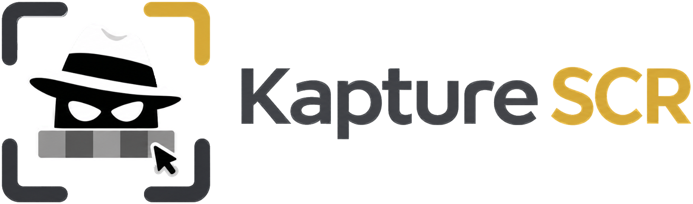

<p align="center">
  
</p>

<p align="center">
  <strong>A private, offline screenshot tool for the macOS menu bar.</strong><br>
  Capture, adjust, mark up, copy and save — with no network access and no telemetry.
</p>

<p align="center">
  <a href="https://github.com/jsujar/kapture_scr/releases/latest"></a>
  <a href="https://github.com/jsujar/kapture_scr/actions/workflows/ci.yml"></a>
  <a href="https://github.com/jsujar/kapture_scr/actions/workflows/codeql.yml"></a>
  
  
  
  <a href="#languages"></a>
  <a href="LICENSE"></a>
</p>

<p align="center">
  <a href="#install">Install</a> ·
  <a href="#features">Features</a> ·
  <a href="#languages">Languages</a> ·
  <a href="#keyboard-shortcuts">Shortcuts</a> ·
  <a href="#privacy">Privacy</a> ·
  <a href="#build-from-source">Build</a> ·
  <a href="CHANGELOG.md">Changelog</a>
</p>

---

## Why Kapture SCR

- **Private by design.** No networking code and no network entitlement. Captures stay on your Mac, in memory or in the folder you choose.
- **Native and light.** Written in Swift with AppKit and SwiftUI. No dependencies, and no background polling while idle.
- **Made for macOS.** Liquid Glass surfaces in light and dark, menu bar first, and 15 languages including right-to-left layouts.

## Install

1. Download **`Kapture SCR <version>.dmg`** from the [latest release](https://github.com/jsujar/kapture_scr/releases/latest).
2. Open it and drag **Kapture SCR** to **Applications**.
3. The app is not notarized, so on first launch macOS says it cannot verify the developer. Open **System Settings › Privacy & Security** and click **Open Anyway**. You only do this once.
4. Allow **Screen Recording** when asked, then reopen the app.

The Kapture SCR icon appears in the menu bar. Press <kbd>⌘</kbd> <kbd>⇧</kbd> <kbd>6</kbd> to take your first screenshot.

> Requires macOS 14 Sonoma or later. Liquid Glass needs macOS 26; earlier versions use a translucent material.

## Features

### Capture

- **Three modes.**
  - **Selection** uses Kapture SCR's own crosshair overlay.
  - **Window** uses the system camera picker.
  - **Full screen** captures the main display.
- **Capture Window anytime.** <kbd>⌘</kbd> <kbd>⇧</kbd> <kbd>7</kbd> picks a window, whatever mode is selected.
- **Repeat Last Capture.** <kbd>⌘</kbd> <kbd>⇧</kbd> <kbd>8</kbd> takes the last capture again at once, with no timer.
  - **An area:** the same place on screen.
  - **A window:** the same window, even if it has moved or been resized. If it has closed, Kapture SCR says so and starts a normal capture.
  - **Full screen:** the main display.
  - With nothing to repeat yet, it starts a normal capture. The last target is kept in memory only.
- **Destinations.** Save to the clipboard, a folder, or both. Pick the folder once and Kapture SCR remembers it.
- **Options.**
  - Timer: none, 3, 5 or 15 s.
  - Format: PNG or JPG.
  - Show pointer and window shadow.
- **Glass countdown.** Delayed Selection and Full screen captures show a countdown with a progress ring over the area being captured. It disappears before the shot is taken, and <kbd>Esc</kbd> cancels.
- **File handling.**
  - Names look like `Kapture SCR 2026-11-17 13.05.22.png` in every language and never overwrite an existing file.
  - The clipboard always gets lossless PNG; files use the format you chose.

### Selection

- **Capture guide.** A small glass hint follows the pointer. <kbd>Space</kbd> morphs it into an options panel where you pick a timer with the mouse or <kbd>←</kbd> <kbd>→</kbd>. The choice is remembered.
- **Adjustable selection** (optional, *Options › Adjust Capture Area*, off by default).
  - **Off:** releasing the mouse captures the area at once.
  - **On:** the area stays on screen with eight handles.
    - Drag a corner or an edge to resize it, drag inside to move it, or drag outside to start over.
    - Arrow keys move it: <kbd>⇧</kbd> moves it 10 pt at a time, and <kbd>⌥</kbd> resizes it instead.
    - Capture with <kbd>Return</kbd>, a double-click inside, or the *Capture* button under the area.

### Editor

- **Canvas.** A dark canvas with a floating glass toolbar and a filmstrip of recent captures.
- **Tools.** Crop, arrow, text, opaque redaction and highlighter (<kbd>⌘</kbd> <kbd>1</kbd>–<kbd>5</kbd>).
- **Highlighter.** Draw freehand; the stroke is smoothed into one even line. It blends like a marker on paper, so text under it stays readable. Six colours plus a custom one, and three widths. The choice is remembered.
- **Pixel rulers.** Rulers along the top and left edges are numbered in the capture's own pixels (on Retina displays, twice the points you see). They follow the zoom, a line marks the pointer, the image size and pointer position show at the bottom, and dragging shows the size of the area (or the arrow's length). <kbd>⌘</kbd> <kbd>R</kbd> or *… › Hide Rulers* turns them off.
- **Zoom to look at a detail.** Pinch the trackpad over the image, swipe with two fingers to move around, and double-tap with two fingers or press <kbd>⌘</kbd> <kbd>0</kbd> to see the whole image again. It only magnifies the view: the image never changes, and every tool still works while zoomed.
- **Undo and redo.** Up to five steps within 64 MiB.
- **Save Copy** (<kbd>⌘</kbd> <kbd>S</kbd>) writes a new `… (edited).png` next to your captures. The original file is never touched.
- **Copy** (<kbd>⌘</kbd> <kbd>⇧</kbd> <kbd>C</kbd>) puts the edited PNG on the clipboard.

### Watermark and number

Open *Options › Watermark and Number…* to add your logo or signature, a running number, or both, to every capture and imported image. The two tabs share one preview that shows exactly what your captures will get.

**Watermark**

- **Your image.** PNG, JPEG, HEIC or TIFF up to 4096 px. PNG with transparency works best. Kapture SCR keeps a copy in its sandbox container, so the original file can move.
- **Live preview.** The mark is drawn on a sample screenshot exactly as it will appear on your captures. Drag it to place it, or pick one of nine positions.
- **Position, size and opacity.** Horizontal and vertical position go from 0 % (left or top) to 100 % (right or bottom), and the mark always stays inside the capture. Size is a share of the capture's width, so it looks the same on every display.
- **Pattern.** *Repeat as a pattern* tiles the mark over the whole capture; the position then shifts the pattern.
- **Where it goes.** Files, the clipboard and the editor all get the watermarked image. Edits never add it twice. Turn it on or off from *Options › Add Watermark*.

**Number**
- **Counting.** Choose the next number and whether it goes up by one after each capture or import. Turn it off to stamp the same number every time.
- **Look.** Any font installed on your Mac, or the system font, in bold. Six colours plus a custom one; a thin contrasting outline keeps it readable on any background.
- **Position, size and opacity** work like the watermark's: drag it in the preview or pick one of nine positions. Size is a share of the capture's height.
- Turn it on or off from *Options › Add Number*.

### Menu bar

- **Recent captures panel.** Hover over the menu bar icon to see your recent captures in a smoked-glass panel. Click one to edit it, or drag it into another app.
- **Floating thumbnail.** It appears in the top-right corner for 5 seconds after each capture. Click it to open the editor; hovering keeps it visible.
- **Import from the clipboard** (<kbd>⌘</kbd> <kbd>⇧</kbd> <kbd>E</kbd>). Opens the copied image in the editor.
- **Auto images.** Optionally imports PNG and TIFF images you copy. It is off at launch and never saved.
- **Help menu.** *Kapture SCR Help* explains every feature with its current shortcut, *About Kapture SCR* shows how to [verify your copy](#verify-your-copy), and *Check for Updates…* opens the release page in your browser.
- **Open at Login** (*Options › Open at Login*). Registers Kapture SCR as a login item with macOS, so it appears in System Settings › General › Login Items & Extensions.

### Design and languages

- **Liquid Glass.** The guide, options panel, countdown, recent captures panel and editor use Liquid Glass on macOS 26 and later (`glassEffect`, `GlassEffectContainer`), with a translucent fallback on macOS 14–15.
- **Light and dark.** Every surface has both versions and follows the system appearance.
- **Accessibility.** Surfaces respect *Reduce motion* and *Reduce transparency*.
- **15 languages.** The whole interface is translated, including right-to-left layouts. See [Languages](#languages).

## Languages

**Automatic.** Kapture SCR follows the language set in **System Settings › General › Language & Region**. It uses the first language in your list that it has, so with *Catalan, Spanish* it uses Spanish. Regional variants map to the closest translation, for example Portuguese (Portugal) uses Portuguese (Brazil). If none of your languages is available, the app uses English.

**Choose one yourself.** Use *Options › Language* in the menu bar menu, or *Same as System* to go back. Kapture SCR restarts to apply it everywhere, including system dialogs and right-to-left layouts. The recent history lives only in memory, so if it holds screenshots or imported images, Kapture SCR warns you first and lets you restart later. Saved files are never affected. This is the same setting as *Applications* in System Settings › General › Language & Region.

| Language | Native name | Code | Direction |
| --- | --- | --- | --- |
| English | English | `en` | Left to right |
| German | Deutsch | `de` | Left to right |
| Spanish | Español | `es` | Left to right |
| French | Français | `fr` | Left to right |
| Hungarian | Magyar | `hu` | Left to right |
| Norwegian (Bokmål) | Norsk bokmål | `nb` | Left to right |
| Portuguese (Brazil) | Português (Brasil) | `pt-BR` | Left to right |
| Swedish | Svenska | `sv` | Left to right |
| Russian | Русский | `ru` | Left to right |
| Chinese (Simplified) | 简体中文 | `zh-Hans` | Left to right |
| Chinese (Traditional) | 繁體中文 | `zh-Hant` | Left to right |
| Hindi | हिन्दी | `hi` | Left to right |
| Bengali | বাংলা | `bn` | Left to right |
| Arabic | العربية | `ar` | Right to left |
| Urdu | اردو | `ur` | Right to left |

File names stay the same in every language (`Kapture SCR 2026-11-17 13.05.22.png`), so scripts and searches keep working. To add or fix a translation, see [Translations](#translations).

## Keyboard shortcuts

| Action | Default shortcut |
|---|---|
| Take Screenshot | <kbd>⌘</kbd> <kbd>⇧</kbd> <kbd>6</kbd> |
| Capture Window | <kbd>⌘</kbd> <kbd>⇧</kbd> <kbd>7</kbd> |
| Repeat Last Capture | <kbd>⌘</kbd> <kbd>⇧</kbd> <kbd>8</kbd> |
| Import from Clipboard | <kbd>⌘</kbd> <kbd>⇧</kbd> <kbd>E</kbd> |
| Timer options (while selecting) | <kbd>Space</kbd>, then <kbd>←</kbd> <kbd>→</kbd> |
| Capture the adjusted area | <kbd>Return</kbd> |
| Cancel | <kbd>Esc</kbd> |
| Editor tools | <kbd>⌘</kbd> <kbd>1</kbd>–<kbd>5</kbd> |
| Editor zoom | Pinch, two-finger swipe; <kbd>⌘</kbd> <kbd>0</kbd> resets |
| Show or hide rulers | <kbd>⌘</kbd> <kbd>R</kbd> |
| Undo / Redo | <kbd>⌘</kbd> <kbd>Z</kbd> / <kbd>⌘</kbd> <kbd>⇧</kbd> <kbd>Z</kbd> |
| Save Copy · Copy edited image | <kbd>⌘</kbd> <kbd>S</kbd> · <kbd>⌘</kbd> <kbd>⇧</kbd> <kbd>C</kbd> |

**Changing the four global shortcuts.**
- Use *Options › Change Capture Shortcut…*, *Change Window Shortcut…*, *Change Repeat Shortcut…* or *Change Import Shortcut…*.
- A combination needs at least two modifier keys, including <kbd>⌘</kbd> or <kbd>⌃</kbd>. Function keys work on their own.
- Shortcuts reserved by macOS or already taken are rejected.
- *Restore Default* brings back the original shortcut.

## Privacy

- **No network.** No networking code, OCR, auto-updates or telemetry, and no network entitlement. The App Sandbox therefore blocks every connection, and [automated tests](#tests) check this on every change.
- **Updates without connecting.** *Help › Check for Updates…* shows your version and opens the [release page](https://github.com/jsujar/kapture_scr/releases) in your browser. Kapture SCR itself never connects, and nothing is added to the address.
- **Files only where you allow.**
  - Captures and edited copies go to the folder you choose.
  - Preferences, and the copy of your watermark image, live in the app's sandbox container.
  - Each capture passes through a temporary file inside the container, deleted once read.
- **Ephemeral history.** Up to 10 images, kept in memory for 30 minutes, within 128 MiB of raster data.
- **Clean exports.** Exported PNGs contain only the current pixels: no layers and no undo states. Undo keeps the previous image in memory temporarily, and this is not secure memory erasure.
- **No keyboard monitoring.** Global shortcuts use Carbon `RegisterEventHotKey`, so Kapture SCR needs no Accessibility permission.
- **What it cannot control.** Dragging or copying hands data to other processes. Handoff, Universal Clipboard and backups of your capture folder are outside Kapture SCR's control.

**Limits.**
- Own captures: up to 16384 px per side and 50 MP.
- Clipboard imports: up to 8192 px, 16 MP and 48 MiB.

## Verify your copy

*Help › About Kapture SCR* shows the version and build, the git commit and date it was built from (`-modified` means uncommitted changes), who signed it, whether the signature is intact, the App Sandbox, network access and the SHA-256 of the app's executable. Everything is read on your Mac.

A tampered copy could fake that window too, so check it without trusting the app. *Help › Kapture SCR Help* lists these commands with your app's path:

```sh
codesign --verify --deep --strict --verbose=2 "/Applications/Kapture SCR.app"
codesign -d --entitlements - "/Applications/Kapture SCR.app"
shasum -a 256 "/Applications/Kapture SCR.app/Contents/MacOS/Kapture"
```

- The first must report `valid on disk` and `satisfies its Designated Requirement`.
- The second must list only `app-sandbox`, `files.user-selected.read-write` and `files.bookmarks.app-scope`, with no `network` entitlement.
- The SHA-256 must match the one published with the release, next to the disk image's own checksum. `scripts/make-dmg.sh` prints both and writes them to `dist/Kapture SCR <version>.sha256.txt`.

You can also read the source and [build it yourself](#build-from-source).

## Security

- **Reporting a problem.** Please report vulnerabilities privately through the repository's *Security* tab (*Report a vulnerability*), not in a public issue. [SECURITY.md](SECURITY.md) explains what is in scope and what happens next.
- **Code scanning.** [CodeQL](.github/workflows/codeql.yml) analyses the Swift source with the `security-and-quality` queries on every change and every week.
- **Supply chain.** The app has no third-party packages. The GitHub Actions that build and test it are pinned to exact commits and kept up to date by [Dependabot](.github/dependabot.yml); a test fails if an action is not pinned or a workflow token is not read-only.

## Build from source

**Requirements.**
- macOS 14 or later.
- Xcode, the full app: the Command Line Tools alone are not enough on some setups.
- No third-party dependencies.

```sh
git clone https://github.com/jsujar/kapture_scr.git
cd kapture_scr
DEVELOPER_DIR=/Applications/Xcode.app/Contents/Developer ./scripts/build-local.sh
open ~/Applications/"Kapture SCR.app"
```

**What the build script does.**
1. Builds a release binary and wraps it in `dist/Kapture SCR.app`.
2. Signs it with the App Sandbox entitlements.
3. Installs it to `~/Applications`, quitting any running copy first.
4. Removes the build copy, so Spotlight and the Apps launcher list only the installed app.

Pass `--no-install` to only build into `dist/`.

> Do not run the binary in `.build/` directly: it lacks the signature and therefore the sandbox. Do not disable Gatekeeper or SIP. If you downloaded the source as an archive, remove only its quarantine flag: `xattr -dr com.apple.quarantine .`

### Tests

```sh
DEVELOPER_DIR=/Applications/Xcode.app/Contents/Developer swift test
```

**What the unit tests cover.**
- **No network, in three layers.**
  - Entitlements: the App Sandbox is on, there is no network entitlement, and no new entitlement can be added unnoticed.
  - Source: no networking, web, telemetry or URL-opening APIs, no remote addresses, and no helper process besides `screencapture`.
  - Binary: the compiled app links no networking framework and imports no socket or URL-loading function.
- **Image limits.** Oversized, truncated or invalid images are rejected, as are images over the pixel and byte limits.
- **History.** Up to 10 images and 128 MiB, expiry after 30 minutes, and selection after removal.
- **Watermark.** Position, size, opacity, transparency and pattern, and that captures, imports and saved files get it exactly once.
- **Number.** Placement, size, font fallback, outline contrast, counting up or staying fixed, and drawing together with the watermark.
- **Highlighter.** It tints white in the chosen colour, leaves black text black, follows the chosen width, and undo restores the image.
- **About.** Version, commit, signature, sandbox and network facts, the checksum, the commands to verify a copy, and that the release page is a fixed address with no data attached.
- **Repeat capture.** The `screencapture` arguments for an area (including displays above or left of the main one), a window and the full screen, and finding the window that was picked.
- **Edits and undo.** Redact, crop, arrow and text change exactly the expected pixels, and undo restores them exactly. Undo is limited to 5 steps and 64 MiB.
- **Files.** Saving never overwrites an existing file, and file names are the same in every language.
- **Shortcuts.** Combination rules, shortcuts reserved by macOS, symbol order and storage.
- **Repository.** GitHub Actions are pinned to exact commits, workflow tokens are read-only, Dependabot watches the actions, and there are no third-party packages.
- **Languages.** All 15 translations are complete, keep their placeholders and match `Info.plist` and the *Language* menu, and macOS picks the expected one for regional settings (for example Portuguese (Portugal) → Portuguese (Brazil)).

**Coverage.** `./scripts/coverage.sh` runs the tests with code coverage. The tests target the logic: about three quarters of the history, editing, file and shortcut code runs under test. Most of the source is user interface, so the overall figure is low.

**Continuous integration.** [GitHub Actions](.github/workflows/ci.yml) runs the tests and the translation check on every push and pull request. It also builds the signed app and checks that it has the sandbox and no network entitlement.

**Load test.** `./scripts/loadtest/run.sh` runs about 5,000 captures, edits, copies and saves with the app's own code. It reports latency percentiles, memory use and any slowdown over time, and takes a few minutes. Run it by hand before a release: it is not part of continuous integration.

### Disk image

```sh
DEVELOPER_DIR=/Applications/Xcode.app/Contents/Developer ./scripts/make-dmg.sh
```

**What it creates.** `dist/Kapture SCR <version>.dmg`, containing:
- a drag-to-install window with the app, a link to *Applications* and a background with first-launch instructions;
- the app icon as the volume icon.

**Window layout.** Arranging the window needs permission for Terminal to control Finder the first time (*System Settings › Privacy & Security › Automation*). Without it the image is still built, just without the layout.

**Signing.** The app is signed with the local certificate, or ad hoc, and is **not notarized**, which would need a paid Apple Developer account. Updates signed with the same certificate keep the Screen Recording permission on other Macs.

### Signing and the Screen Recording permission

Kapture SCR captures through `/usr/sbin/screencapture`, so macOS asks for **Screen Recording** permission the first time. Reopen the app after granting it.

macOS ties that permission to the app's code signature, and an ad hoc signature loses it on every rebuild. To keep it across builds:
- Create a self-signed **code signing** certificate named `Kapture Local Signing` in your login keychain (*Keychain Access › Certificate Assistant › Create a Certificate…*, type *Code Signing*). No Apple account is needed.
- The build scripts use it automatically when present, and fall back to ad hoc signing otherwise.

If you delete or replace the certificate, reset the old grant:

```sh
tccutil reset ScreenCapture local.kapture.app
```

**Entitlements.**

| Entitlement | Purpose |
|---|---|
| `com.apple.security.app-sandbox` | App Sandbox |
| `com.apple.security.files.user-selected.read-write` | Only the folder you choose |
| `com.apple.security.files.bookmarks.app-scope` | Remembering that folder |

There is **no** network entitlement.

### Translations

**Where strings live.**
- In the code, user-facing strings use English keys looked up with `L("…")` in `Sources/Kapture/main.swift`.
- Translations are in `Resources/<language>.lproj/Localizable.strings`, and the build script copies them into the app.

**After adding or changing a string**, update every `Localizable.strings` file and run:

```sh
python3 scripts/check-strings.py
```

It lists missing or unused keys for each language.

### Project layout

```
Sources/Kapture/main.swift    App, capture flow, overlay, editor and panels
Resources/                    Icons, logo and Localizable.strings for 15 languages
Tests/KaptureTests/           Unit tests
scripts/                      Build, disk image, coverage, load test and translation check scripts
.github/workflows/ci.yml      Continuous integration
.github/workflows/codeql.yml  CodeQL code scanning
.github/dependabot.yml        Dependabot updates for the GitHub Actions
SECURITY.md                   How to report a vulnerability
logo/                         Brand assets (see License)
Info.plist                    Bundle metadata
Kapture.entitlements          App Sandbox entitlements
```

## Version history

See [CHANGELOG.md](CHANGELOG.md).

## License

The source code is released under the [MIT License](LICENSE).

The *Kapture SCR* name and logo are not licensed for use in other products. This covers `logo/`, the app icon and the menu bar icon. Forks and derivative apps must use their own name and artwork.
